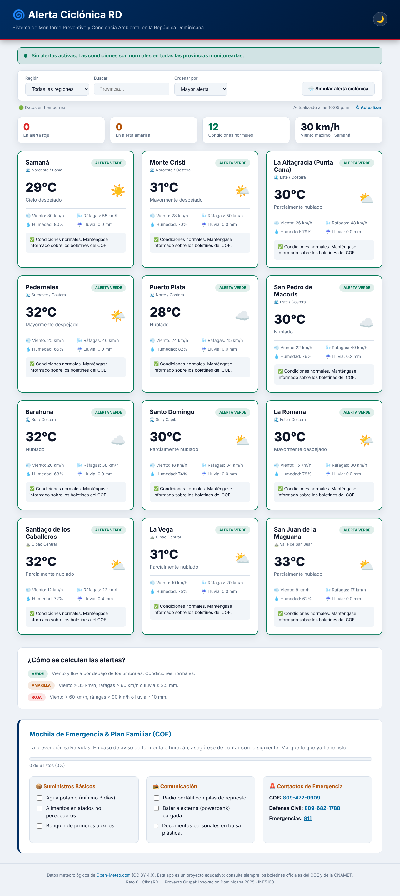
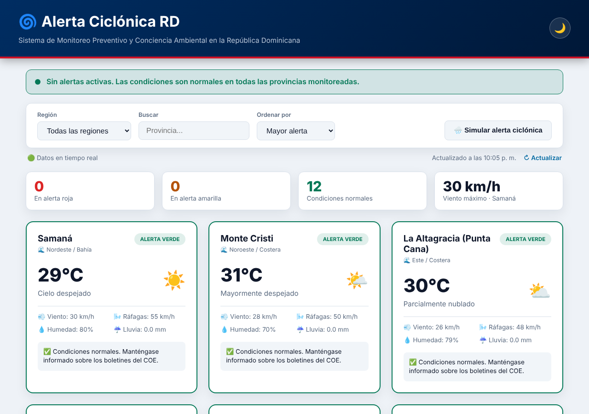
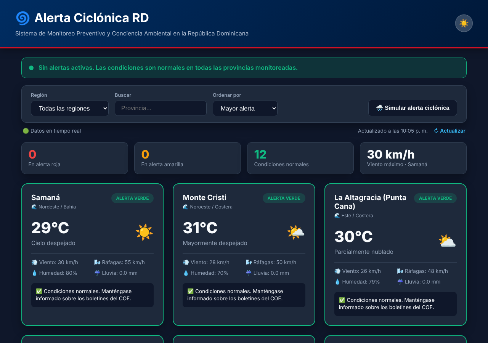
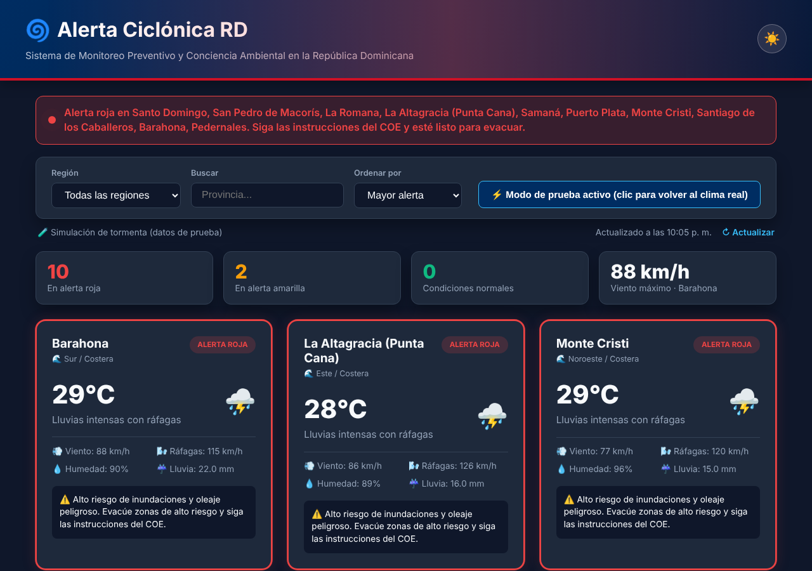
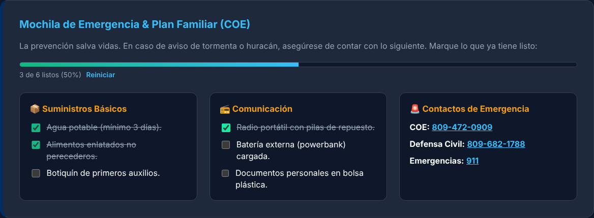
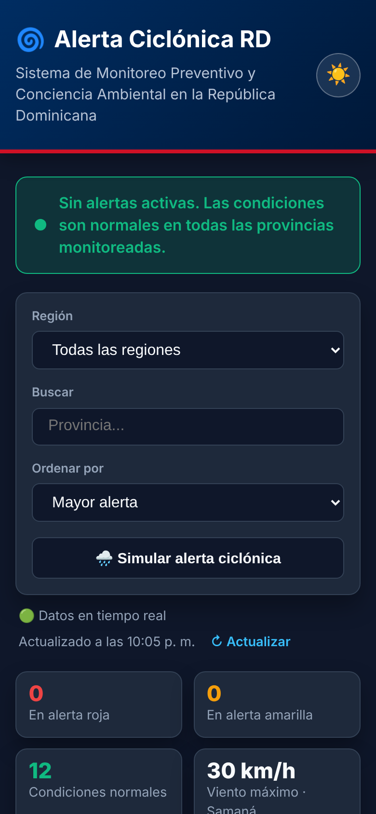

# 🌀 ClimaRD — Alerta Ciclónica RD

> **Reto 6 · "ClimaRD"** — Proyecto Grupal: Innovación Dominicana 2025 con React
> Lenguaje de Programación III · INF5160



## 👥 Grupo e integrantes

**Grupo:** ClimaRD (Reto 6)

| Integrante |
| --- |
| Jordany Enmanuel Sosa Medina |

## 📖 Descripción del proyecto

La temporada de huracanes preocupa a las comunidades costeras de la República Dominicana.
**ClimaRD** es una aplicación web que muestra el clima de **12 provincias** (costeras y del interior),
calcula un **semáforo de alertas** (verde, amarilla y roja) y presenta **mensajes preventivos** para fomentar
una cultura de prevención y conciencia ambiental.

### Funcionalidades

- 🌡️ **Clima en tiempo real** de 12 provincias: temperatura, viento, ráfagas, humedad y lluvia.
- 🚦 **Alertas visuales** por provincia (verde / amarilla / roja) y un banner general con las zonas afectadas.
- 📊 **Resumen nacional**: cantidad de provincias por nivel de alerta y viento máximo.
- 🌧️ **Simulador de alerta ciclónica** para demostrar el sistema sin depender del clima real.
- 🔎 **Filtro por región**, **búsqueda** (sin importar acentos) y **orden** por alerta, nombre, temperatura o viento.
- 🎒 **Mochila de emergencia interactiva**: lista de verificación con barra de progreso que se guarda en el navegador.
- 📞 Contactos de emergencia con enlaces para llamar (COE, Defensa Civil, 911).
- 🌙 **Modo claro / oscuro** que recuerda la preferencia del usuario.
- ✨ **Animaciones CSS**: ciclón giratorio, tarjetas que aparecen en cascada, pulso en alertas rojas y esqueleto de carga
  (respetan `prefers-reduced-motion`).
- 📱 Diseño **responsive** y accesible (etiquetas, `aria-live`, foco visible).
- 🔌 Si no hay conexión con el servicio meteorológico, la app **sigue funcionando con datos simulados** y lo avisa.

### ¿Cómo se calculan las alertas?

| Nivel | Condición |
| --- | --- |
| 🟢 Verde | Por debajo de los umbrales de abajo. |
| 🟡 Amarilla | Viento > 35 km/h, ráfagas > 60 km/h o lluvia ≥ 2.5 mm |
| 🔴 Roja | Viento > 60 km/h, ráfagas > 90 km/h o lluvia ≥ 10 mm (o zona costera en modo simulación) |

## 📸 Capturas de pantalla

| Modo claro | Modo oscuro |
| --- | --- |
|  |  |

**Simulación de alerta ciclónica**



**Mochila de emergencia interactiva**



**Versión móvil**



## 🛠️ Tecnologías usadas

- **React 19** (componentes funcionales, hooks `useState`, `useEffect`, `useMemo` y hooks personalizados)
- **JavaScript (ES2022)**
- **HTML5** semántico
- **CSS3** puro (variables CSS, Grid, Flexbox, animaciones, modo oscuro)
- **Vite** como herramienta de desarrollo y empaquetado, con React Compiler
- **API Open-Meteo** (gratuita, sin API key) para el clima en tiempo real
- **ESLint** para la calidad del código
- **Git** para el control de versiones (ver `evidencia_historial.txt`)

## 🗂️ Estructura del proyecto

```text
climard/
├── public/                  # favicon.svg
├── src/
│   ├── components/          # Header, AlertBanner, SummaryBar, Controls, ProvinceCard,
│   │                        # AlertLegend, PreventionSection, Footer
│   ├── data/provinces.js    # provincias, coordenadas y filtros de región
│   ├── hooks/               # useWeather, useLocalStorage
│   ├── services/weather.js  # consulta a Open-Meteo y datos simulados
│   ├── utils/alerts.js      # reglas del semáforo de alertas
│   ├── App.jsx · App.css · index.css · main.jsx
├── capturas/                # capturas de pantalla
├── evidencia_historial.txt  # historial de Git
└── package.json
```

## 🚀 Cómo ejecutarlo

Requisitos: [Node.js](https://nodejs.org/) 20 o superior.

```bash
npm install        # instala las dependencias
npm run dev        # servidor de desarrollo en http://localhost:5173
npm run build      # genera la carpeta dist/ para producción
npm run preview    # prueba local de la versión de producción
npm run lint       # revisa el código con ESLint
```

No se necesita ninguna clave: Open-Meteo es de uso gratuito.

## 🎓 Qué aprendimos

- A dividir una interfaz en **componentes reutilizables** de React y a manejar **estado** con hooks.
- A consumir una **API REST** con `fetch`, manejar errores y ofrecer un **plan alternativo** (datos simulados) cuando falla.
- A crear **hooks personalizados** (`useWeather`, `useLocalStorage`) para separar la lógica de la interfaz.
- A **derivar datos** (filtrar, buscar y ordenar con `useMemo`) en lugar de duplicar estado.
- A diseñar con **CSS moderno**: variables para temas claro/oscuro, Grid responsive y animaciones accesibles.
- A usar **Git** con commits descriptivos y a preparar un proyecto para desplegarlo.
- La importancia de la **prevención** ante huracanes y de comunicar información de riesgo de forma clara.

## 🌐 Despliegue

La app es estática y está lista para publicarse (`base: './'` en `vite.config.js`).

- **GitHub Pages:** sube el proyecto a un repositorio y activa *Settings → Pages → Source: GitHub Actions*.
  El flujo `.github/workflows/deploy.yml` compila y publica en cada `push` a `main`.
- **Netlify / Vercel:** importa el repositorio con *Build command* `npm run build` y *Output directory* `dist`.

## 🙏 Créditos y aviso

- Datos meteorológicos: [Open-Meteo.com](https://open-meteo.com/) (licencia CC BY 4.0).
- Proyecto educativo: ante una emergencia real consulte los boletines oficiales del **COE** y la **ONAMET**.
